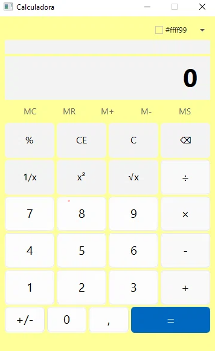

# Calculadora JavaFX

Uma calculadora desktop moderna desenvolvida em JavaFX, inspirada no design da calculadora nativa do Windows 10/11. Possui uma interface limpa, operações matemáticas padrão e um seletor de cores integrado para personalização do tema.



## Funcionalidades

- **Operações Básicas:** Adição, subtração, multiplicação e divisão.
- **Funções Avançadas:** Porcentagem, inverso (1/x), quadrado (x²) e raiz quadrada (√x).
- **Controlos:** Botão de limpar (C), limpar entrada (CE), apagar último dígito (⌫) e inversão de sinal (+/-).
- **Personalização:** Seletor de cores (ColorPicker) que altera o fundo da aplicação em tempo real.
- **Histórico:** Exibição do cálculo anterior acima do visor principal.

## Tecnologias Utilizadas

- **Linguagem:** Java 17+
- **Interface Gráfica:** JavaFX 21
- **Estilização:** CSS (JavaFX CSS)
- **IDE:** Apache NetBeans (Java with Ant)
- **Controlo de Versão:** Git e GitHub

## Como Executar o Projeto

### Pré-requisitos
- Java Development Kit (JDK) 17 ou superior instalado.
- JavaFX SDK (versão 21 recomendada) descarregado.
- NetBeans IDE.

### Passos para execução

1. Clona o repositório:
   ```bash
   git clone https://github.com/MarioGomes7/calculadora-javafx.git
